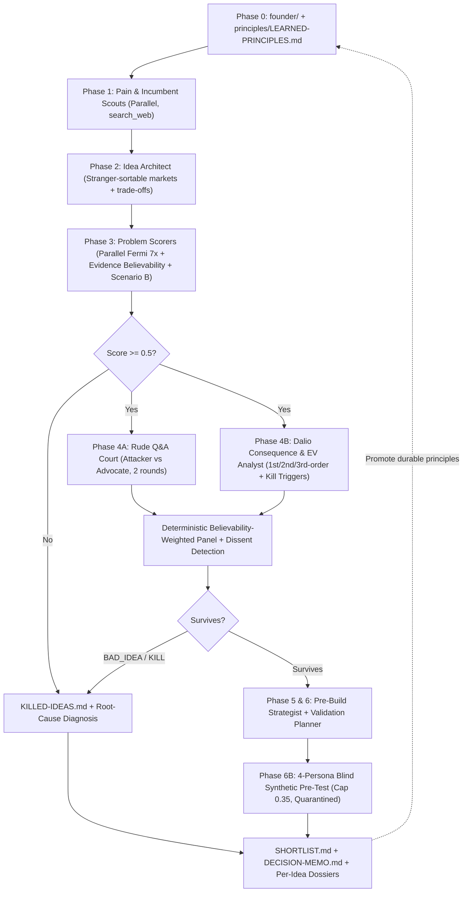

# ASB Indie Idea Foundry (A Smart Bear + Ray Dalio Principles + Grounded Synthetic Pre-Tests)

A multi-agent entrepreneurial idea discovery and decision system uniting Jason Cohen's **18 A Smart Bear (ASB) skills**, **Ray Dalio's Decision-Making Principles**, and **blind, web-grounded synthetic persona interviews** — strictly stopping **before writing any product code**.

---

## Triple-Layer Design: ASB × Ray Dalio × Grounded Synthetic Pre-Tests

| Layer | Jason Cohen (ASB) | Ray Dalio (Principles) |
| :--- | :--- | :--- |
| **Upstream Inputs** | `asb-who-me` (`WHO-ME.md`), `asb-voters` (`VOTERS.md`) | Step 1 (Clear Goals) + `principles/LEARNED-PRINCIPLES.md` (evolving machine memory) |
| **Market Scouting** | `asb-carol-observations` (External Research) + `asb-carol-inciting-events` | Step 2 (Identify Problems) + Primary vs. Secondary Evidence Believability (`1.0 / 0.7 / 0.4 / 0.2`) |
| **Viability & Synthesis** | `asb-problem` (7x Fermi math `÷ 625,000` + Scenario B narrowing) | Evidence Believability Index (EBI) + Root-Cause persistence check (*why hasn't this been solved?*) |
| **Adversarial Triangulation** | `asb-rude-qa` (2-round Attacker vs. Advocate, Opposite Test, 70%+ threats) | **Believability-Weighted Specialist Panel** (Scorer `0.30` · Attacker `0.40` · Consequence/EV Analyst `0.30`) + Mandatory **Disagreement Log** |
| **Strategy & Pre-Flight Simulation** | `asb-needs-stack`, `asb-carol-*`, `asb-positioning`, `asb-interview-goals/hypotheses/questions` | **1st / 2nd / 3rd-Order Consequences**, EV & **Pre-Committed Kill Triggers**, + **4-Persona Blind Synthetic Pre-Test** (quarantined in `synthetic-interviews/`, capped at Believability **`0.35`**) |
| **Human Field Validation & Reflection** | Real human interviews (`asb-interview-debrief` → `learning` → `report`) | Step 3–5 (**Pain + Reflection = Progress**): Proximate vs. Root-Cause diagnosis of killed ideas → Candidate Principles promoted to `principles/LEARNED-PRINCIPLES.md` |

*(Full references: [asb-framework-map.md](file:///Users/albertjoseph/projects/asb/.agents/skills/asb-indie-ideation/references/asb-framework-map.md) · [dalio-decision-principles.md](file:///Users/albertjoseph/projects/asb/.agents/skills/asb-indie-ideation/references/dalio-decision-principles.md) · [synthetic-interview-protocol.md](file:///Users/albertjoseph/projects/asb/.agents/skills/asb-indie-ideation/references/synthetic-interview-protocol.md).)*

---

## Multi-Agent Pipeline



---

## Quick Start

### 1. (Optional, Recommended) Add Founder Context
- Run `asb-who-me` and `asb-voters` into `founder/WHO-ME.md` and `founder/VOTERS.md`, **or** copy `founder/FOUNDER-PROFILE.template.md` to `founder/FOUNDER-PROFILE.md`.
- Review [principles/LEARNED-PRINCIPLES.md](file:///Users/albertjoseph/projects/asb/principles/LEARNED-PRINCIPLES.md).

### 2. Run Multi-Agent Discovery, Deep Dive, or Standalone Synthetic Interviews
Ask the assistant in this workspace:
- *"Run an indie idea discovery sprint on vertical B2B SaaS for trades/compliance and developer tooling."* (`workflows/discover_ideas.py`)
- *"Run a deep dive + 4-persona synthetic interview pre-test on this idea: [pitch]."* (`workflows/deep_dive_idea.py`)
- *"Run grounded synthetic persona interviews on `runs/<run-id>/ideas/<slug>` to debug our questions and surface objections."* (`workflows/run_synthetic_interviews.py`)

### 3. Verify All Math, Quarantine & Artifacts
```bash
python3 scripts/validate_scorecard.py --self-test
python3 scripts/validate_scorecard.py runs/<run-id>/
```
